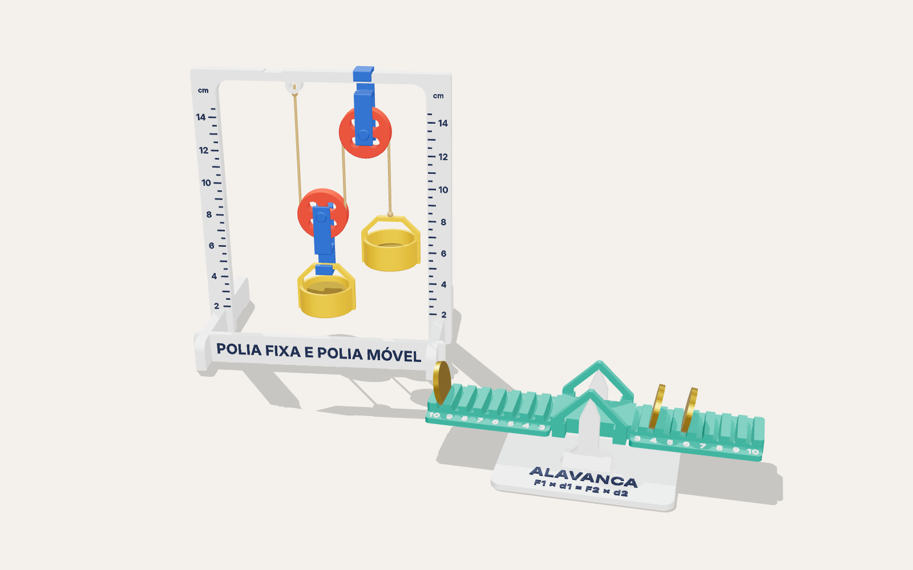
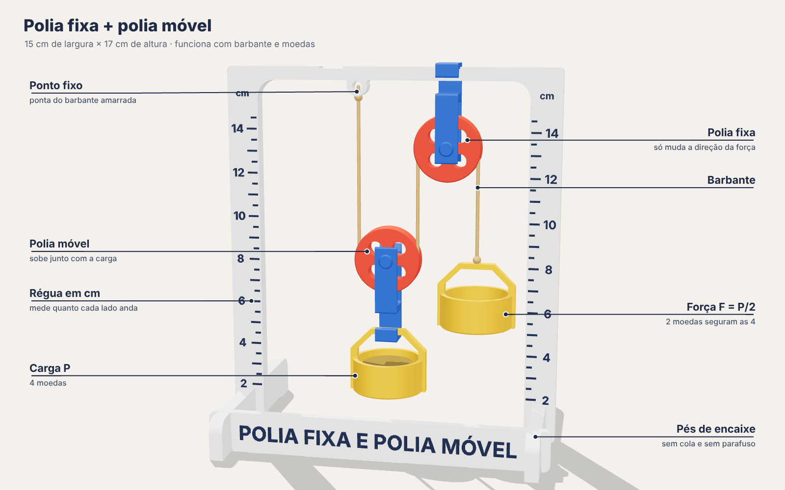
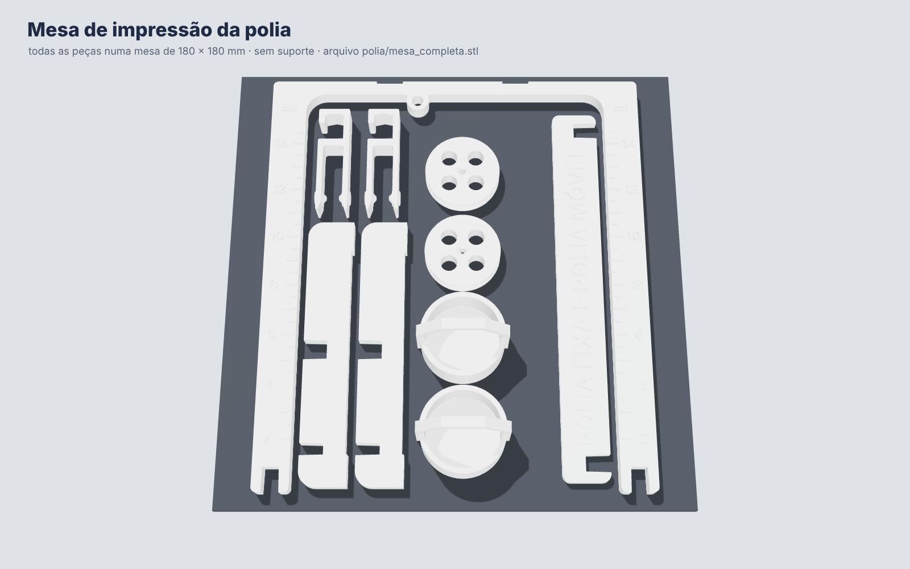
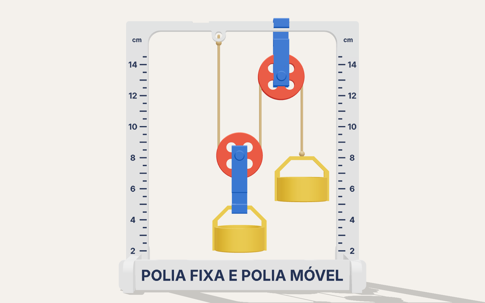
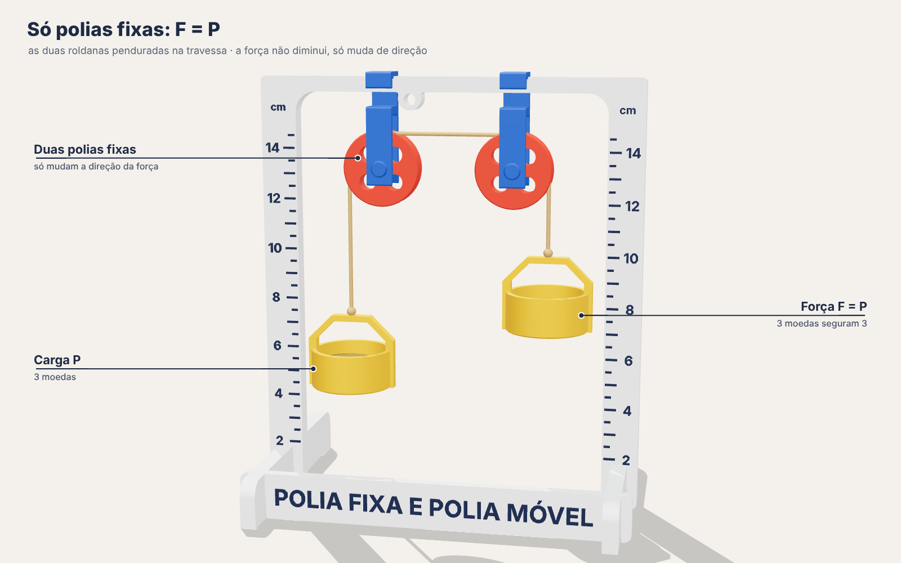
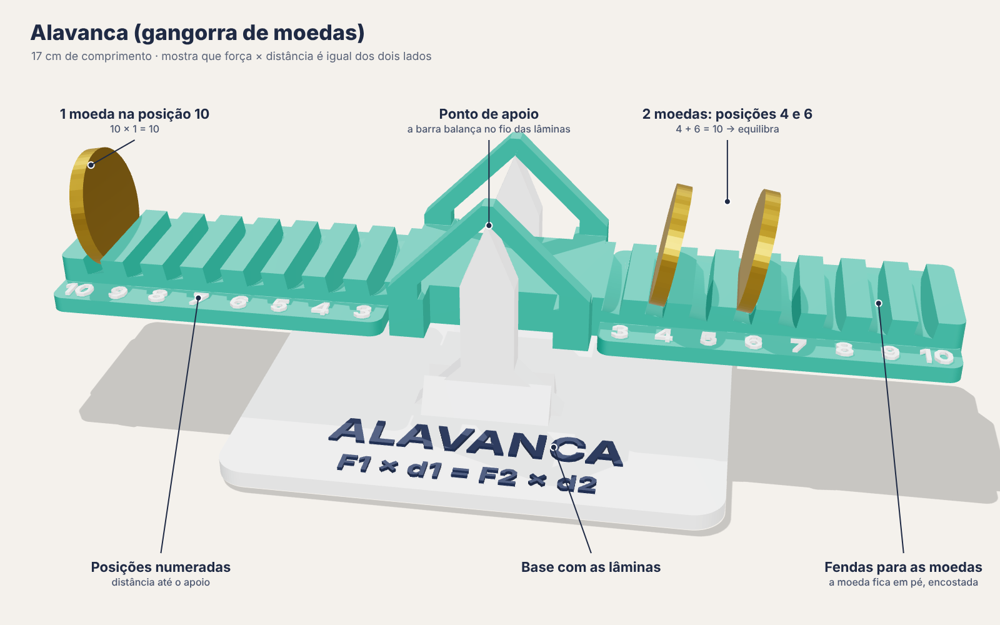
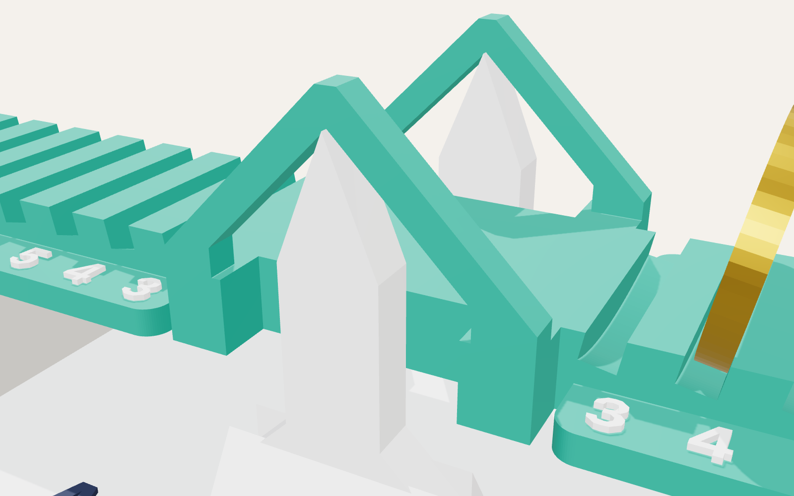
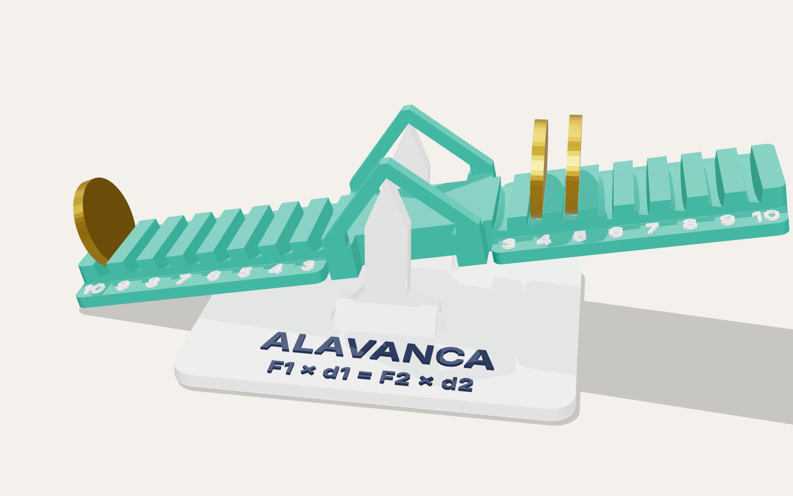

# Máquinas simples em 3D: polia e alavanca (projeto de Física)

Dois modelos que **funcionam de verdade**, para o trabalho "exemplo de polia ou de alavanca".
Escolha um deles (ou imprima os dois):



| | Polia fixa + polia móvel | Alavanca (gangorra de moedas) |
|---|---|---|
| O que mostra | com a polia móvel a força cai pela metade: **F = P/2** | força × distância é igual dos dois lados: **F1 × d1 = F2 × d2** |
| Peças impressas | 10 (6 arquivos) | 2 |
| Filamento (aprox.) | 85 g | 60 g |
| Além da impressora | 50 cm de barbante e moedas iguais | moedas iguais |
| Montagem | encaixe, sem cola (uns 5 minutos) | é só apoiar a barra na base |
| Tamanho montado | 15 × 10 × 17 cm | 17 × 7 × 5 cm |

A alavanca é a mais simples de imprimir e montar. A polia impressiona mais.

Tudo imprime **sem suporte** e cabe numa mesa de **180 × 180 mm**. Os arquivos já estão na
posição certa de impressão: não gire.

---

## 1. Polia fixa + polia móvel



### Peças (`stl/polia/`)

| Arquivo | Qtd. | O que é |
|---|---|---|
| `01_portico.stl` | 1 | a armação, com régua em centímetros nas duas pernas (150 × 168 mm) |
| `02_pe.stl` | 2 | pés de encaixe |
| `03_placa_titulo.stl` | 1 | placa "POLIA FIXA E POLIA MÓVEL", que une os dois pés |
| `04_garfo_da_roldana.stl` | 2 | garfo com gancho que segura a roldana |
| `05_roldana.stl` | 2 | a roda da polia, com sulco para o barbante |
| `06_balde.stl` | 2 | baldinho para as moedas (cabe até moeda de R$ 1) |
| `mesa_completa.stl` | 1 | **tudo acima já arrumado numa mesa só** (150 × 168 mm) |
| `01_portico_alto.stl` | (1) | opcional, no lugar do 01: pórtico de 210 mm para mesa de 220 mm ou mais. A carga sobe 8 cm em vez de 4 cm |



### Montagem

1. **Pés:** encaixe cada perna do pórtico na fenda do meio de um pé, empurrando até o fim. A régua fica virada para a frente e a fenda menor dos pés também fica na frente.
2. **Placa do título:** encaixe a placa nas fendas da frente dos dois pés.
3. **Roldanas:** empurre cada roldana entre os dois braços de um garfo, pela ponta aberta, até dar o clique. Os braços abrem um pouco e os dois pinos cônicos entram no centro da roldana. Gire algumas vezes para amaciar.
4. **Polia fixa:** pendure um garfo na travessa de cima, no rebaixo da direita. A travessa entra pela abertura lateral do gancho.
5. **Barbante:** amarre uma ponta no olhal (o anel embaixo da travessa). Segure o garfo solto com o gancho para baixo e passe o barbante por baixo da roldana dele. Depois suba, passe por cima da roldana pendurada e amarre a outra ponta na alça de um balde.
6. **Carga:** pendure o outro balde no gancho do garfo solto (a polia móvel).



### Experiências para apresentar

Use moedas iguais (todas de 50 centavos, por exemplo).

**Experiência 1 — polia fixa: F = P**



Pendure os dois garfos na travessa (há um rebaixo para cada um), passe o barbante por cima das
duas roldanas e amarre um balde em cada ponta.

- 3 moedas de cada lado: fica parado em qualquer altura.
- Puxe um balde 4 cm para baixo: o outro sobe os mesmos 4 cm (confira na régua).
- Tire uma moeda de um lado: o lado mais pesado desce.

Conclusão: a polia fixa **não diminui a força**, só muda a direção (puxar para baixo é mais fácil que puxar para cima).

**Experiência 2 — polia móvel: F = P/2**

Monte como na primeira imagem (passos 4 a 6).

- 4 moedas na carga e só **2 moedas** no outro balde: fica parado. Metade da força segura a carga.
- Puxe o balde da força 8 cm para baixo: a carga sobe só 4 cm.
- Volte para a montagem da experiência 1 e tente segurar 4 moedas com 2: não segura.

Conclusão: a polia móvel **divide a força por 2**, mas é preciso puxar o **dobro** de barbante.
Não se ganha energia: o trabalho é o mesmo (F × distância).

### A Física em duas linhas

- A carga fica pendurada em **dois** trechos do barbante. Cada trecho segura metade do peso, e você só puxa um deles: F = P/2.
- O que se ganha em força se perde em distância: (P/2) × (2 × altura) = P × altura.

No dia a dia: guindaste, elevador, varal de teto, aparelhos de academia, talha de oficina.

### O que esperar do modelo

- Existe atrito nos pinos. Por isso o conjunto fica parado mesmo com uma pequena diferença de peso. Com 4 contra 2 ele equilibra; com 6 contra 2 a carga desce.
- A polia móvel e o balde dela também pesam. O balde do outro lado já compensa isso (as massas foram calculadas para dar aproximadamente metade).
- Para girar mais solto: risque os pinos cônicos com lápis (grafite) ou pingue uma gota de óleo.
- Use barbante de 1 a 2 mm. Linha muito fina pode entrar entre a roldana e o garfo.

---

## 2. Alavanca (gangorra de moedas)



### Peças (`stl/alavanca/`)

| Arquivo | Qtd. | O que é |
|---|---|---|
| `01_base.stl` | 1 | base com as duas lâminas (o ponto de apoio) |
| `02_barra.stl` | 1 | barra de 17 cm com fendas numeradas de 3 a 10 de cada lado |
| `mesa_completa.stl` | 1 | as duas peças arrumadas numa mesa só (170 × 114 mm) |

### Montagem

Apoie a barra na base: as duas "orelhas" em forma de A encaixam por cima das lâminas.
A barra vazia fica na horizontal.



### Experiências para apresentar

As moedas ficam em pé nas fendas. O número é a distância até o ponto de apoio
(cada número vale 8 mm). Use moedas iguais.

1. **Braços iguais:** uma moeda no 6 de cada lado. Equilibra.
2. **Uma moeda equilibra duas:** uma moeda no **10** de um lado; do outro, moedas no **4** e no **6**. Equilibra, porque 10 = 4 + 6.
3. **Duas equilibram três:** moedas no 10 e no 5 de um lado (15); do outro, no 4, 5 e 6 (15).
4. **Desequilíbrio:** mude uma moeda de fenda. A barra inclina para o lado em que a soma é maior.
5. **Moedas diferentes:** a mais pesada precisa ficar mais perto do apoio para equilibrar a mais leve.



A regra para moedas iguais: **a soma dos números de um lado tem que ser igual à soma do outro**.

### A Física em duas linhas

- O que faz a barra girar é o **momento** (torque) = força × distância até o apoio.
- Há equilíbrio quando os momentos dos dois lados são iguais: **F1 × d1 = F2 × d2**. Por isso uma força pequena, longe do apoio, vence uma força grande que está perto.

Tipos de alavanca:

| Tipo | O que fica no meio | Exemplos |
|---|---|---|
| Interfixa | o ponto de apoio | gangorra, tesoura, alicate, balança (**é o caso deste modelo**) |
| Inter-resistente | a carga | carrinho de mão, quebra-nozes, abridor de garrafa |
| Interpotente | a força | pinça, vara de pescar, antebraço |

### Detalhes do projeto

- **O apoio fica acima das moedas**, como numa balança. Assim o equilíbrio é estável: a barra volta para a horizontal quando os dois lados empatam.
- **As fendas são inclinadas de propósito.** A moeda sempre encosta na parede de fora, e o centro dela cai em cima do número, seja qual for a espessura (erro menor que 0,5 mm).
- Uma moeda fora do lugar por uma fenda inclina a barra uns 5°. Por duas fendas, a ponta chega perto de encostar na mesa (o limite é 12°).

---

## Como imprimir

| Ajuste | Valor |
|---|---|
| Material | PLA |
| Altura de camada | 0,2 mm |
| Paredes | 3 |
| Preenchimento | 15 % |
| Suporte | não |
| Borda (brim) | desligada (na mesa completa as peças ficam a 3 mm uma da outra) |
| Saia (skirt) | desligada se a sua mesa tiver só 180 mm |

- Sugestão de cores: pórtico, pés, placa e base em branco; garfos em azul; roldanas em vermelho; baldes em amarelo; barra da alavanca em verde. Em uma cor só também funciona (`imagens/11_uma_cor.png`).
- Os números e as letras saem **em relevo**. Para ficarem escuros como nas imagens, passe canetinha permanente por cima depois de imprimir.
- Encaixe dos pés apertado demais: lixe de leve a fenda. Frouxo demais: uma gota de cola resolve.

## Para mudar o projeto

Todas as medidas estão no começo de `gerar_modelos.py`. O script gera os STL e confere
sozinho as folgas e os encaixes:

```bash
pip install manifold3d trimesh numpy matplotlib
python3 gerar_modelos.py              # gera tudo em stl/
python3 gerar_modelos.py --verificar  # só confere folgas e encaixes
```
