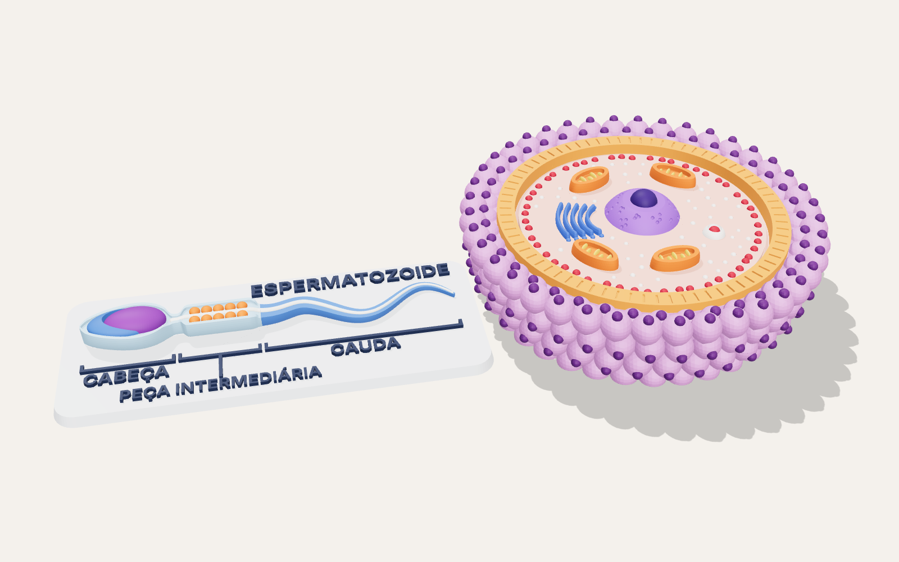
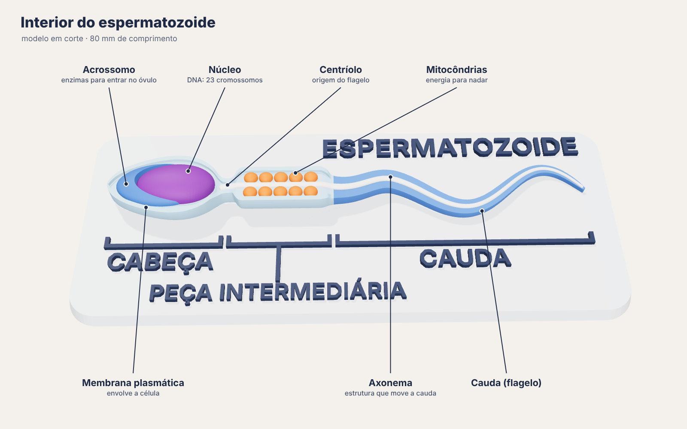
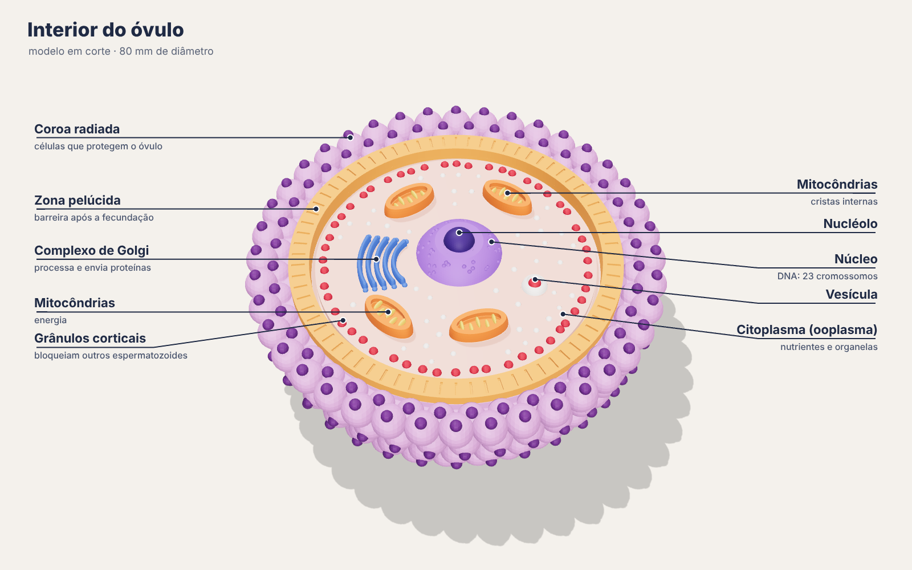

# Modelos 3D: interior do espermatozoide e do óvulo

Dois modelos didáticos **em corte** baseados na ilustração "Interior do espermatozoide /
Interior do óvulo". A face de cima de cada peça é o plano de corte, e as estruturas
internas aparecem em relevo.



| Espermatozoide | Óvulo |
|---|---|
|  |  |

## O que tem em cada modelo

**Espermatozoide** (80 mm de comprimento, sobre uma base de 90 × 37 mm):
acrossomo (capuz em crescente), núcleo, membrana plasmática (borda em relevo), centríolo,
mitocôndrias da peça intermediária, axonema percorrendo a cauda e a cauda (flagelo).
A base tem os títulos **CABEÇA**, **PEÇA INTERMEDIÁRIA** e **CAUDA** com as chaves, como na ilustração.

**Óvulo** (80 mm de diâmetro, 23 mm de altura):
coroa radiada (células com núcleo, cobrindo toda a lateral), zona pelúcida com estrias,
espaço perivitelino (sulco), citoplasma (ooplasma), núcleo cortado mostrando o nucléolo e os
poros nucleares, 4 mitocôndrias abertas mostrando as cristas, complexo de Golgi com vesículas,
grânulos corticais em anel e pequenas vesículas espalhadas.

## Arquivos

```
stl/
  espermatozoide_completo.stl   <- peça única (imprimir em 1 cor)
  ovulo_completo.stl            <- peça única (imprimir em 1 cor)
  espermatozoide/01_base.stl ... 08_cauda.stl      <- uma peça por cor
  ovulo/01_coroa_radiada.stl ... 11_vesiculas.stl  <- uma peça por cor
imagens/                        <- renderizações de como fica o resultado
gerar_modelos.py                <- script que gera todos os STL
```

Todos os STL foram verificados: malhas fechadas, sem furos e sem faces invertidas.

## Como imprimir

Nenhum dos dois precisa de suporte. Os dois saem na orientação certa: **não gire**.

| | Espermatozoide | Óvulo |
|---|---|---|
| Altura de camada | 0,12 mm (os detalhes são pequenos) | 0,12 a 0,16 mm |
| Paredes | 3 | 3 |
| Preenchimento | 15 % | 10 a 15 % |
| Suporte | não | não |
| Filamento (PLA, aprox.) | ~12 g | ~42 g |

A lateral do óvulo é inclinada no máximo ~30°, e as células da coroa radiada têm formato de
gota (ponta para baixo a 45°) para imprimir sem suporte. O corpo do espermatozoide afina para
baixo em no máximo ~45°.

### Opção 1: uma cor e pintar (qualquer impressora)

Imprima `espermatozoide_completo.stl` e `ovulo_completo.stl` em PLA branco e pinte com tinta
acrílica (pincel fino para os detalhes). Use as cores da tabela abaixo, ou veja
`imagens/07_impressao_uma_cor.png` para ver como fica antes de pintar.

### Opção 2: multicolorida (AMS, MMU, Prusa XL, etc.)

1. No Bambu Studio, OrcaSlicer ou PrusaSlicer, selecione **todos** os arquivos de
   `stl/ovulo/` (ou de `stl/espermatozoide/`) e arraste juntos para o fatiador.
2. Quando perguntar *"Carregar como um único objeto com várias partes?"*, clique **Sim**.
   As peças já estão encaixadas na posição certa.
3. Atribua um filamento a cada parte. Com só 4 cores, use a mesma cor em várias partes
   (sugestão na última coluna).

**Espermatozoide**

| Parte | Cor sugerida | Com 4 cores |
|---|---|---|
| 01_base | cinza-claro `#e9edf2` | branco |
| 02_textos | azul-marinho `#22314f` | roxo |
| 03_membrana | azul-claro `#a9d3f0` | azul |
| 04_acrossomo | azul `#3f74c9` | azul |
| 05_nucleo | roxo `#7b3fa0` | roxo |
| 06_mitocondrias | laranja `#e8702a` | laranja |
| 07_axonema | branco `#f3f1ea` | branco |
| 08_cauda | azul `#4a7fd4` | azul |

**Óvulo**

| Parte | Cor sugerida | Com 4 cores |
|---|---|---|
| 01_coroa_radiada | lilás `#c98ccf` | roxo |
| 02_nucleos_coroa | roxo-escuro `#5e2a74` | roxo |
| 03_zona_pelucida | laranja `#f2913f` | laranja |
| 04_citoplasma | rosa-claro `#f6b4a6` | branco |
| 05_nucleo | violeta `#8a63d2` | roxo |
| 06_nucleolo | índigo `#3a2470` | roxo |
| 07_mitocondrias | laranja `#e8702a` | laranja |
| 08_mitocondrias_cristas | amarelo `#f7c24a` | branco |
| 09_golgi | azul `#3f6fd6` | azul |
| 10_granulos | vermelho `#b3263a` | laranja |
| 11_vesiculas | branco `#f6eeea` | branco |

## Mudar o tamanho

Escale no fatiador (ex.: 125 % = 100 mm) ou gere de novo:

```bash
pip install manifold3d trimesh numpy scipy matplotlib
python3 gerar_modelos.py --escala 1.25   # 100 mm
```

Não recomendo menos de 80 % (64 mm): os menores detalhes (grânulos, cristas, letras) ficam
abaixo de 0,5 mm e o bico de 0,4 mm não consegue imprimir.

## Observação sobre a escala

Os dois modelos têm 8 cm para facilitar a visualização. Na realidade o óvulo humano tem cerca
de 0,1 mm de diâmetro e o espermatozoide cerca de 0,05 mm de comprimento. Ou seja, o óvulo
é um pouco mais que o dobro do comprimento do espermatozoide.
